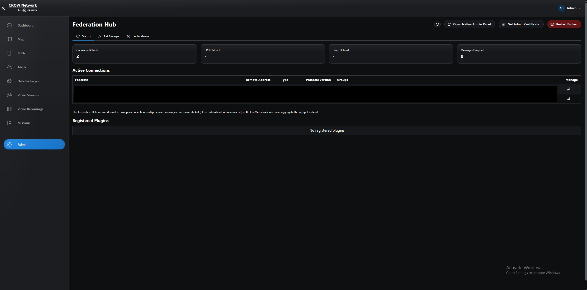
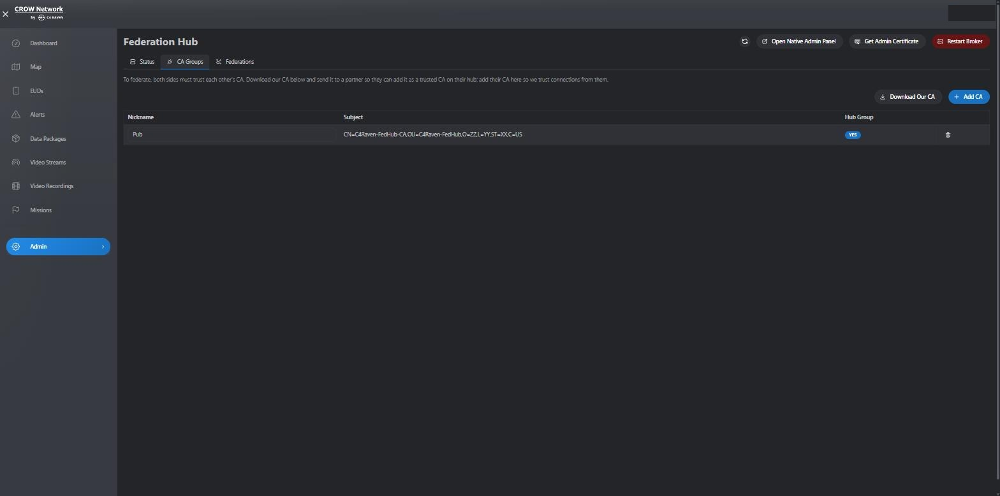
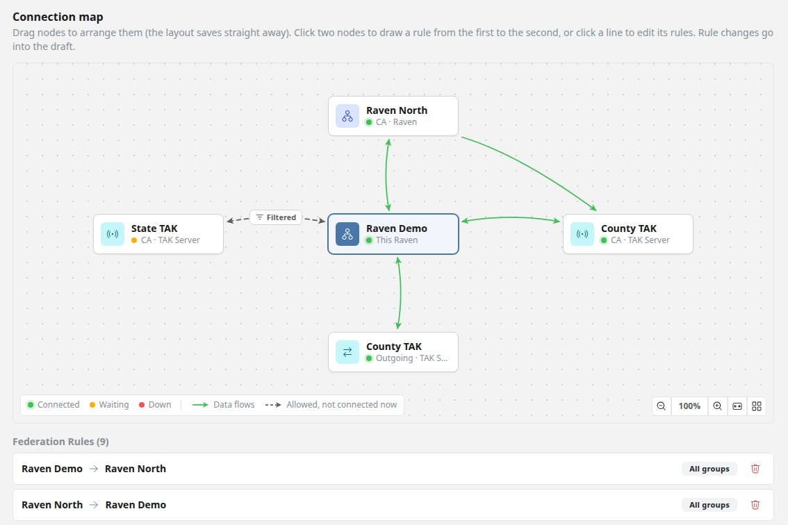
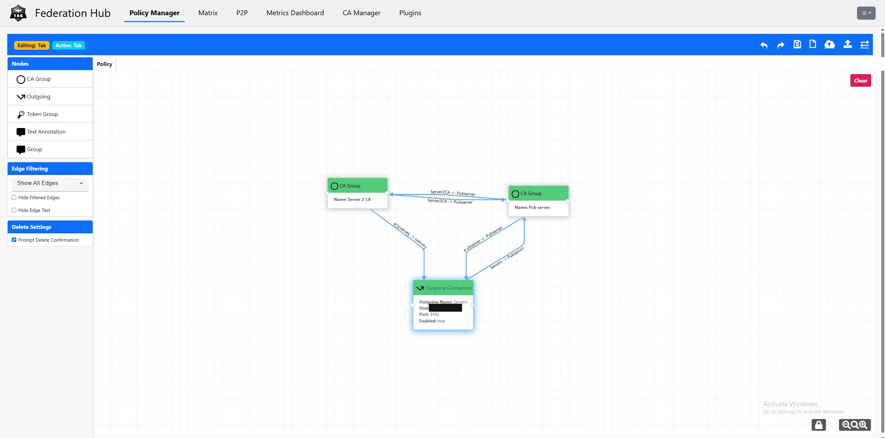
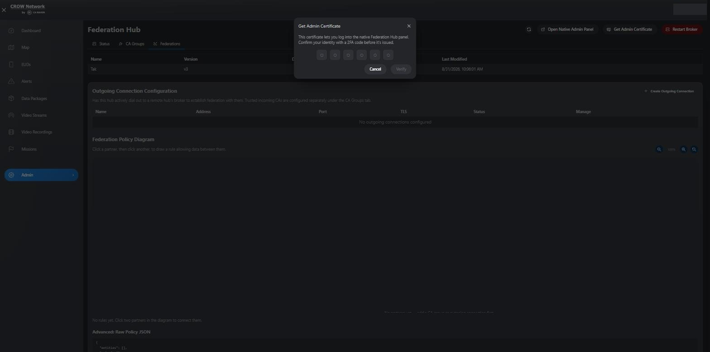

# Federation Hub tab

A Raven-styled admin tab for managing the TAK Server Federation Hub, added so
day-to-day federation management doesn't require the native Federation Hub
admin console's client certificate. All calls are proxied server-side by
`raven` (see `c4raven-server`'s `federation_hub_api.py`) using a dedicated
`fedhub-admin` mTLS client cert the backend holds on the admin's behalf --
browsers never need that cert imported to use this tab.

## Connect a server

**Connect a server** opens a five-step guide: **Server type**, **Swap
certificates**, **Who connects**, **What to share** and **Review &
connect**. The first step offers two choices:

- **Raven** (Recommended): another C4 Raven server with its own Federation
  Hub.
- **TAK Server**: a TAK Server with its own TAK Federation Hub. Raven
  links to their hub (usually port 9102), which passes data on to their
  TAK Server.

There is no follow-up question. The TAK Server must run TAK Federation
Hub: Raven does not link to a TAK Server without one. The partner type
labels (the icon tooltip on a partner card, the review step, the
instructions) are **Raven** and **TAK Server**. Older partners made with
a direct link to a TAK Server show **TAK Server (direct link)** and keep
working, but new ones can't be made.

No certificate fingerprints are shown in the guide, the status strip,
the partner cards or the connection maps. In **Swap certificates**,
**Download instructions for the other admin** saves
`federation-instructions.zip` with `federation-instructions.txt` (the
steps that match the choice) and `federation-hub-ca.pem` (our CA); an
uploaded CA shows its **Subject** and expiry only.

Step-by-step guide for admins:
[Connect Raven to a TAK Server](https://c4raven.net).

## Status

Broker metrics, active federation connections, and registered plugins for the
local Federation Hub instance.

## CA Groups

Manage which CAs this hub trusts for inbound federation connections, and
download this hub's own CA to hand to a partner so they can trust us back.

## Connection map

The main page shows the active policy as a **Connection map** under the
partner cards (`src/components/FederationPolicyDiagram.tsx`, layout in
`federationMap.ts`). This Raven sits in the middle, highlighted and
labelled **This Raven**; partners are cards around it with a kind icon
(**Raven** or **TAK Server**) and a live status dot (Connected, Waiting,
Down). Curved arrows show which way data may flow: solid green when both
ends are connected and data flows, dashed when the policy allows it but
the link is not connected now. A **Filtered** pill marks a rule with a
group filter. The legend is bottom-left, zoom and **Fit to view**
bottom-right, hovering a server highlights its links, and a **Links (N)**
list under the map summarises each pair (for example **All groups · both
ways**). Nodes are labelled by name, never by certificate fingerprint.

**Advanced** > **Policy editor** uses the same map to edit a draft policy:
drag nodes (or **Arrange around this server**), click two nodes to draw a
rule from the first to the second (Escape cancels), click a line to edit
its rules, and delete rules from the **Federation Rules** list under the
map. Nothing reaches the hub until **Save & apply**. This is the same
click-to-connect model as the native Federation Hub console's policy
editor, rebuilt so it doesn't need the client cert.

For comparison, this is the same policy graph in Federation Hub's own native
console -- the model this tab was built to match:

## Native admin panel access

The native Federation Hub console (port 9100) still requires its own client
certificate for mTLS login -- a bug in this Federation Hub release's built-in
Keycloak/OAuth support meant that couldn't be replaced with a cert-free login
(confirmed via the actual token exchange and Federation Hub's own JWT
validation code; the token is valid, the app's own filter still rejects it).
Rather than leave that cert to be passed around out-of-band, any Raven admin
can now self-serve it from this tab, gated behind a 2FA check:

